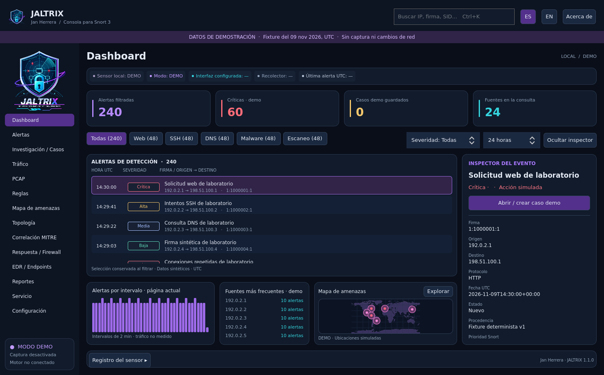
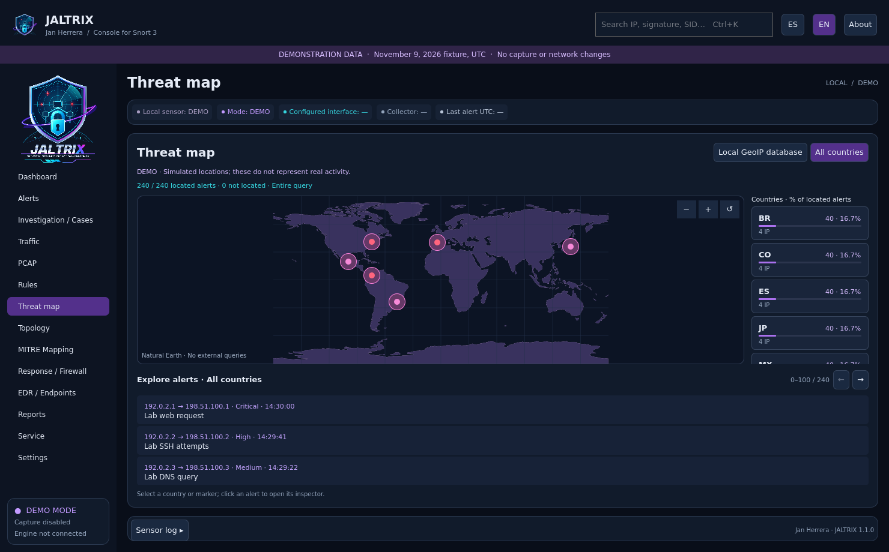

# JALTRIX


[Español](README.md) · English

**Version 1.1.0**, an independent native Linux investigation and response console for Snort 3, developed by **Jan Herrera**. GPL-3.0-or-later. [Developer profile](https://github.com/Lupo-SysAdmin).

American English and Latin American Spanish interfaces. Owner-supplied vector logo, scalable Linux shield icon, developer credits and component license notices. No affiliation with Cisco/Talos or Linux distributions is implied.

## Features

- Transactional alert ingestion, SQL pagination and filters, complete query exports, and an independent user-session collector.
- Persistent triage, notes, bookmarks, cases and scoped triage annotations.
- PCAP/PCAPNG exploration, evidence hashing, packet bytes and real rootless Snort replay.
- Rule drafts, real validation, reviewed deployment and rollback for the explicitly installed managed sensor.
- Local interface telemetry, observed alert relationships, analyst-authored ATT&CK mappings and an offline world map with country grouping and alert drilldown using local GeoIP data ([guide](docs/GEOIP.md)).
- Administrator-authorized, time-limited nftables response with a default-disabled target policy.
- Private backups, verified SQLite snapshots and restore into a new directory.

EDR isolation and restoration are **disabled**: no provider is configured. This is a local desktop application, not a multiuser SIEM or remotely managed EDR service. Stable means the documented release scope passed its release checks; it does not promise detection of every intrusion or universal platform support.

## Install and run

Requires Python >=3.11 and PySide6 >=6.8,<7. Install the native package matching a tested distribution. The GUI does not bundle Snort or commercial rule sets and does not automatically activate capture.

```sh
sudo apt install ./jaltrix_1.1.0-1_all.deb
jaltrix
```

From source: `./run.sh`. For checks: `QT_QPA_PLATFORM=offscreen QT_QUICK_BACKEND=software python3 -m pytest -q -ra`. Engine integration tests explicitly skip if Snort is unavailable.

Package, command and desktop identity now use JALTRIX. See [migration](docs/MIGRATION.md) for upgrades from the old package. User data lives under `$XDG_DATA_HOME/jaltrix`, normally `~/.local/share/jaltrix`, separated into demo/replay/live. Data is retained when removing the GUI package.

## Backup

Use Configuration → Save backup, or `jaltrix --backup /path/backup.zip`. Restore offline with `jaltrix --restore /path/backup.zip --data-dir /path/new-directory`. The destination must not exist. Backups contain sensitive data and are not encrypted; protect them appropriately. Each SQLite database is independently consistent, not a distributed transaction across all databases. System sensor configuration and firewall state are not part of a user-data backup.

See [validation](docs/VALIDATION.md), [compatibility](docs/COMPATIBILITY_MATRIX.md), [release notes and limits](docs/RELEASE.md), [security](SECURITY.md) and [licenses](NOTICE). A successful GUI test is not a successful Snort integration test. The sensor starts at system boot only if explicitly enabled; the separate user collector starts at login.



Keyboard: **Ctrl+Q** quits the desktop window using the native Qt Quit shortcut; independently running sensor/collector services keep their state. **Ctrl+K** focuses search.

The map and classification counters cover the complete filtered source query. Real locations require a local GeoIP CSV; demo locations are explicitly simulated. The status strip distinguishes service state, configured interface, collector health and last source alert. It does not claim verified packet capture.


