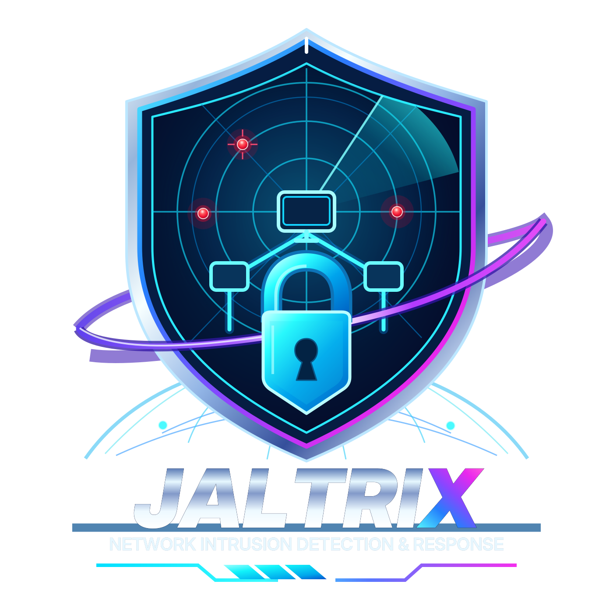
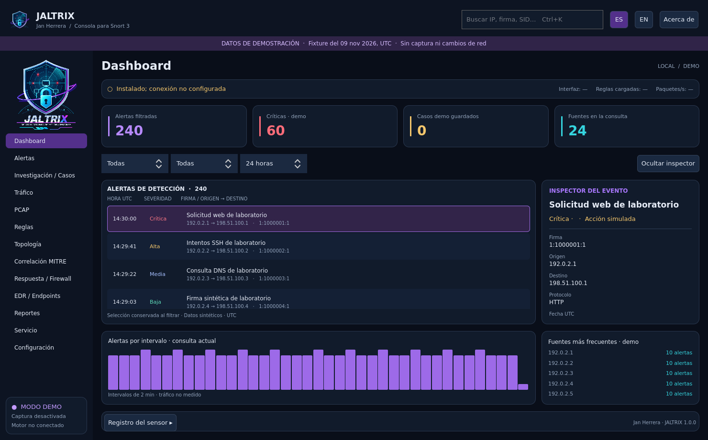
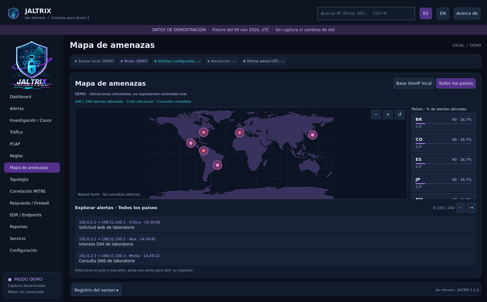
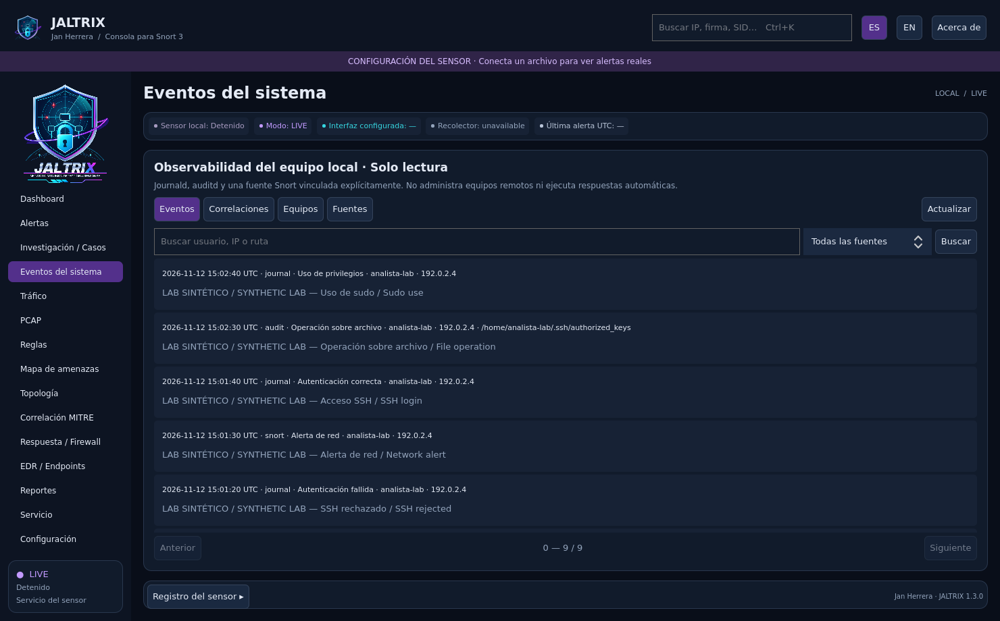

# JALTRIX

**JALTRIX es una aplicación de escritorio para Linux que reúne alertas de Snort 3 y eventos locales del sistema en una consola gráfica de investigación y respuesta.** Permite explorar actividad sospechosa, relacionar evidencias, gestionar casos y administrar el sensor desde una interfaz en español latinoamericano e inglés estadounidense. Está pensada para analistas de seguridad, administradores de sistemas y laboratorios de aprendizaje.

Una instalación nueva abre el **asistente de configuración**: detecta Snort 3, enlaza su instalación oficial y permite conectar alertas existentes o crear un servicio propio. El modo demo se elige explícitamente. [Primer inicio](docs/SETUP.md).



[English](README.en.md) · Español

[Descargar JALTRIX 1.3.0](https://github.com/Lupo-SysAdmin/JALTRIX/releases/tag/v1.3.0) · [Tutoriales de instalación en Kali y Parrot](docs/TUTORIALS.md) · [Comprobaciones de GitHub Actions](https://github.com/Lupo-SysAdmin/JALTRIX/actions)

Consola nativa Linux de investigación y respuesta para Snort 3, desarrollada por **Jan Herrera**. [GitHub del desarrollador](https://github.com/Lupo-SysAdmin). Versión **1.3.0**, GPL-3.0-or-later.

Interfaz **ES (español latinoamericano) / EN (inglés estadounidense)** con preferencia persistente, modo demo separado, icono propio y Acerca de con autoría, licencia y componentes. JALTRIX es independiente de Snort/Cisco/Talos. Su disponibilidad como marca no está certificada; [procedencia del emblema](docs/BRANDING.md).

## Funciones

- Eventos locales de Linux: journald y registros existentes de auditd, equipos observados, tres correlaciones SSH explicables y cronologías enlazadas a casos. Fuentes opcionales, deshabilitadas inicialmente; [configuración y límites](docs/LOCAL_OBSERVABILITY.md).
- Ingesta `alert_json` con checkpoints SQLite, cuarentena, recuperación de rotación y recolector independiente de la ventana mediante systemd de usuario.
- Consulta paginada de la base completa, filtros por tiempo, severidad, texto, IP/CIDR, SID, protocolo y puerto. Exportación JSON/CSV de **toda la consulta**, con procedencia y neutralización de fórmulas CSV.
- Copias de seguridad privadas con snapshots SQLite, hashes y restauración verificada en un directorio nuevo.
- Triage persistente: estado, notas, etiquetas, favoritos, revisión concurrente, casos e historial. Excepciones temporales anotan alertas; no las ocultan ni desactivan detección.
- PCAP y PCAPNG: evidencia copiada y hash SHA-256, explorador de paquetes y bytes, apertura externa y replay real con Snort sin root. PCAPNG compatible se convierte conservando el original.
- Reglas: editor, borrador desde una alerta, validación real `Snort -T`, vista previa de cambios, despliegue del perfil administrado y rollback con autenticación nativa.
- Sensor: iniciar/detener, arranque del sistema, configuración de interfaz/HOME_NET y consulta de journal. GUI sin root; helper instalado de alcance limitado.
- Telemetría real de interfaz; topología de relaciones observadas; mapeos ATT&CK manuales, versionados y justificados; mapa mundial offline con marcadores, países y exploración de alertas; GeoIP aproximada con CSV local del operador ([guía](docs/GEOIP.md)).
- Respuesta nftables: vista previa, motivo, autenticación de administrador, política de destinos permitidos, bloqueo temporal verificado, consulta y revocación. **Deshabilitada por defecto.** No modifica tablas ajenas.
- EDR: contrato y denegación por defecto. **Aislamiento/restauración deshabilitados por decisión del propietario, sin proveedor configurado.**

## Uso

Requiere Python >=3.11 y PySide6 >=6.8,<7. El motor Snort se instala por separado; demo e investigación de archivos funcionan sin él.

```sh
./run.sh
./run.sh --pcap tests/fixtures/lab/benign.pcapng --rules tests/fixtures/lab/local.rules
QT_QPA_PLATFORM=offscreen QT_QUICK_BACKEND=software python3 -m pytest -q -ra
python3 tools/build_deb.py
```

Instalación Debian: `sudo apt install ./dist/jaltrix_1.3.0-1_all.deb`. El paquete **no instala automáticamente un sensor ni modifica reglas de Snort existentes**. El perfil opcional administrado usa `/etc/jaltrix`, separado de `/etc/snort`. Véanse [servicio](docs/SERVICE.md), [manual operativo](docs/USER_GUIDE.md) y [empaquetado](docs/PACKAGING.md).

Actualizaciones del paquete anterior: [guía de migración](docs/MIGRATION.md).

Datos en `$XDG_DATA_HOME/jaltrix/` (por defecto `~/.local/share/jaltrix/`), separados en `demo`, `replay` y `live`. `--data-dir` permite un laboratorio independiente. El recolector de usuario arranca **al iniciar sesión**; el sensor systemd puede arrancar con el sistema. La retención de alertas Snort es explícita y preserva alertas asociadas a casos; inicialmente está desactivada. La base adicional de eventos del sistema usa 30 días y 100.000 registros al activar sus fuentes, protegiendo las evidencias fijadas por casos.

## Validación y límites

[Resultados](docs/VALIDATION.md) · [Matriz de plataformas](docs/COMPATIBILITY_MATRIX.md) · [Seguridad](SECURITY.md) · [Arquitectura](docs/ARCHITECTURE.md) · [Cambios](CHANGELOG.md) · [Publicación 1.3.0](docs/RELEASE.md).

Se ha probado el escritorio en Kali y en VMs KVM de Ubuntu, Parrot, Fedora y Arch. Las pruebas de motor y respuesta tienen un alcance distinto del lanzamiento de la GUI; la matriz distingue PASS, SKIP y lo no ejecutado.

Esta versión no se presenta como certificación de producción ni de compatibilidad universal. No incluye EDR real, RBAC multiusuario, almacenamiento cifrado propio, auditoría remota inmutable ni actualización automática de reglas comerciales. Las gráficas de intervalos, fuentes frecuentes y topología describen la **página actual**; el mapa, los contadores de categorías y la exportación abarcan la consulta completa. Los mapeos ATT&CK requieren evaluación del analista y no prueban una técnica por sí solos. GeoIP no atribuye personas ni atacantes.

## Licencia y créditos

Copyright © 2026 Jan Herrera. [LICENSE](LICENSE) · [NOTICE](NOTICE) · [AUTHORS](AUTHORS). Snort se ejecuta como proceso separado; Qt, PySide6 y demás componentes conservan sus licencias. El inventario legal integrado declara componentes directos y procedencia, no una auditoría exhaustiva de dependencias transitivas.





Ejemplo de eventos del sistema con **evidencia sintética de laboratorio**:


